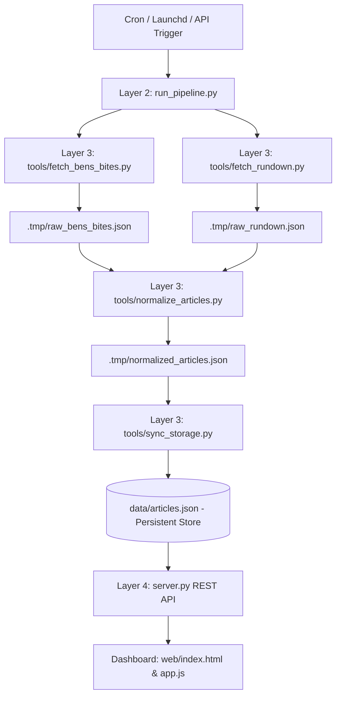

# ✨ AI News Assistant

> **A personalized, deterministic 24-hour AI news radar tracking frontier models, breakthroughs, and industry dispatches.**  
> Built with the **B.L.A.S.T.** protocol (*Blueprint, Link, Architect, Stylize, Trigger*) and the **A.N.T.** 3-Layer Architecture.

---

## 🌟 Key Features

- **⚡ 24-Hour Freshness Radar:** Concurrently scrapes and extracts authentic publication timestamps (`<meta property="article:published_time">` / RFC 822) to filter breaking dispatches from the last 24 hours with dedicated freshness badges (`🔥 NEW`).
- **🛡️ Deterministic Normalization & Deduplication:** Normalizes article URLs, strips tracking parameters, and computes deterministic `SHA-256(canonical_url)[:16]` identifiers. Re-scraping never duplicates articles or drops user state.
- **💖 Dual State Persistence:** Bookmarks persist both in the local JSON storage (`data/articles.json`) and in the browser `localStorage` mirror, surviving daemon re-runs and browser refreshes.
- **🔍 Instant Relevance Search:** Real-time client-side search across titles, summaries, tags, and authors with keyword highlighting (`<mark>`), one-click clear, and query feedback tags.
- **🎨 Glassmorphic Dashboard Design:** Tailored with a sleek dark palette (`#0D1117`, `#1C1520`), soft brand rose accents (`#FFB9CD`), and floating golden sparkle logo.
- **🔄 Autonomous Trigger Integration:** Includes on-demand manual sync (`/api/sync`) and an automated macOS `launchd` background agent (`com.hippo.ainews.pipeline`) scheduled daily at 07:30.

---

## 🏛️ System Architecture (A.N.T. 3-Layer Build)



- **Layer 1 (Architecture):** Standard Operating Procedures in `architecture/`:
  - `SOP_ingestion.md`: Feed collection and raw payload schemas.
  - `SOP_normalization.md`: URL canonicalization, freshness checks, and hashing.
  - `SOP_persistence.md`: Atomic file writing and bookmark preservation invariants.
  - `SOP_trigger.md`: Automated scheduling daemon configuration.
- **Layer 2 (Navigation):** `run_pipeline.py` orchestrates the deterministic ingestion, normalization, and synchronization cycle in under 2 seconds.
- **Layer 3 (Tools):** Atomic Python scripts in `tools/` with standard exit codes and validated inputs/outputs.
- **Layer 4 (Stylize & Presentation):** Lightweight HTTP server (`server.py`) and responsive vanilla frontend (`web/`).

---

## 🚀 Quick Start

### 1. Prerequisites
- Python 3.10+
- Modern Web Browser (Chrome, Safari, Firefox, Edge)

### 2. Clone the Repository
```bash
git clone https://github.com/BiaaniCabrera/AI_news_Assistant.git
cd AI_news_Assistant
```

### 3. Run Pipeline Ingestion
Fetch and normalize the latest dispatches from all sources:
```bash
python3 run_pipeline.py
```
*Output: Articles ingested into `data/articles.json` with 24-hour freshness tags.*

### 4. Launch the Interactive Dashboard
Start the local HTTP and REST API server:
```bash
python3 server.py 8080
```
Open **[http://localhost:8080/](http://localhost:8080/)** in your browser.

---

## 📂 Project Structure

```
.
├── architecture/                 # Layer 1: Technical SOPs
│   ├── SOP_ingestion.md
│   ├── SOP_normalization.md
│   ├── SOP_persistence.md
│   └── SOP_trigger.md
├── tools/                        # Layer 3: Deterministic Tools
│   ├── fetch_bens_bites.py       # Ben's Bites Substack RSS fetcher
│   ├── fetch_rundown.py          # The AI Rundown HTML & timestamp scraper
│   ├── normalize_articles.py     # Deduplication, hashing & 24h classification
│   ├── sync_storage.py           # Atomic JSON store sync & bookmark retention
│   └── test_links.py             # Connectivity & handshake test
├── data/                         # Persistent Storage
│   └── articles.json             # Source of truth for news dispatches
├── web/                          # Layer 4: Modern Dashboard Frontend
│   ├── index.html                # Semantic HTML layout
│   ├── styles.css                # Glassmorphic responsive stylesheet
│   ├── app.js                    # Reactive controller & search engine
│   └── glitter_logo.png          # Transparent golden sparkle logo
├── DesignGuidelines/             # Brand Assets & Reference
│   ├── brandguideline            # Color tokens & typography profile
│   └── glitter_logo.png          # High-resolution brand logo
├── run_pipeline.py               # Layer 2: Main orchestrator
├── server.py                     # Local web server & REST API
├── trigger_daemon.py             # 24h background cron scheduler
├── gemini.md                     # Project Constitution & Data Schemas
└── README.md
```

---

## 📡 REST API Endpoints

| Method | Endpoint | Description |
| :--- | :--- | :--- |
| `GET` | `/api/articles` | Returns the complete dashboard payload, active sources, and sync timestamp. |
| `POST` | `/api/bookmark` | Toggles an article's `is_saved` bookmark status persistently in `data/articles.json`. |
| `POST` | `/api/sync` | Triggers an immediate re-run of `run_pipeline.py` and returns updated articles. |

---

## ⏰ Automated Daily Execution

To schedule autonomous daily updates on macOS, deploy the launchd configuration documented in `architecture/SOP_trigger.md`:

```bash
# Load the agent (runs daily at 07:30 local time)
launchctl load ~/Library/LaunchAgents/com.hippo.ainews.pipeline.plist
```

---

## 📄 License
MIT License. Built for personal AI news tracking and research.
